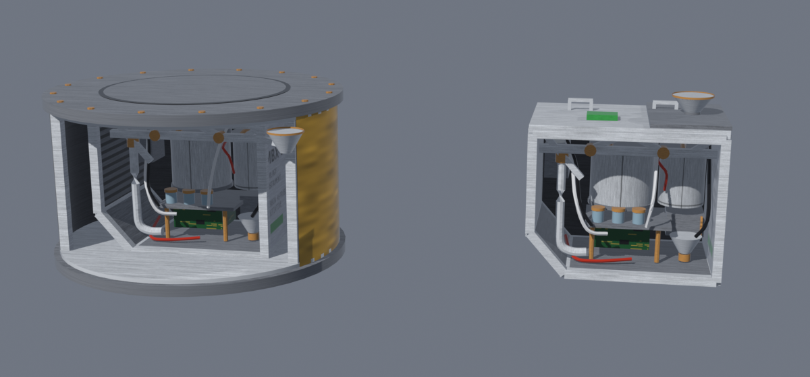

# Microbiology Expansion
A mod for Kerbal Space Program that adds microbial life to Kerbin and the worlds beyond.

Scan for biosignatures, send scientists out on EVA to collect samples, culture them in the Mobile Processing Lab, and piece together the food webs of a dozen alien biospheres.



## Features

### Microbe discovery
- **77 Codex entries** across Kerbin, the Mun, Minmus, Duna, Eve, Jool, Laythe, Tylo, Dres, Eeloo and interplanetary space. Categories: Bacteria, Archaea, Fungi, Protists, Parasites, Viruses, Symbiotes, Metazoa, plus Fossils, Debris and Unknowns that will keep your scientists arguing.
- Each microbe has a home planet, biome and situation restrictions (surface, flight or space), a hazard level, a spawn weight and a science value.
- Detection chance varies by planet. Kerbin teems with life. Finding anything on the Mun takes patience.

### Bioscanning
- **MBX-9 Microbioscanner** (radial) and **MBX-9L Microbioscanner Laboratory Drum** (0.625 m inline). These are biology instrument packages modeled on the Viking Lander Biology Instrument.
- **Mystery Goo Bioscan.** The stock Mystery Goo container can also run bioscans.
- A scan uses ElectricCharge and needs a CommNet connection or a Kerbal on board.

### Samples & the lab
- **EVA sample collection.** Scientists can collect microbe samples and return them to Kerbin for science. Risky specimens need a Level 2 Scientist, and Hazardous specimens need Level 3.
- Experiment Storage Units, Experiment Return Units and the Mobile Processing Lab can store multiple samples.
- **Lab processing.** Process samples in the Mobile Processing Lab for bonus science. Higher-level scientists finish faster.

### Trophic web
- 58 predator–prey, parasite–host and decomposer relations across every inhabited world.
- A relation is revealed in the Codex once **both** species have been processed in the lab.

### Microbiology Codex
- An in-game catalogue with icons, descriptions, discovery dates, the Kerbal who made each discovery, biomes found, samples recovered and the trophic relations you've revealed.
- Filter by hazard level, hide undiscovered entries, and sort by planet, biome, category, discovery date, rarity or hazard.

### Kerbal experience
- Discovering microbes earns XP for the crew member who ran the scan. Hazardous discoveries earn the most.

## Installation
1. Install **[Module Manager](https://forum.kerbalspaceprogram.com/topic/50533-module-manager/)** (required).
2. Download the latest release `.zip`.
3. Merge the zip's `GameData` folder into your KSP `GameData` folder.
4. The final path should be `GameData/MicrobiologyExpansion/`.

If you're upgrading from v0.1.x, delete the old `GameData/MicrobiologyExpansion` folder first. Your save's discoveries are kept.

## Compatibility
- KSP 1.12.x.
- Should work alongside most mods. Microbes only spawn on bodies defined in `Microbes.cfg`, so planet packs need their own entries.
- Supports KSP-AVC / CKAN version checking.

## Adding your own microbes
Every microbe is a `MICROBE` node, and any `.cfg` in GameData can add more. All fields are documented at the top of `Resources/Microbes.cfg`. A minimal example:

```
MICROBE
{
	name = Examplus Kerbinii
	category = Bacteria
	homePlanet = Kerbin
	biomes = Shores,Water
	situation = Surface
	hazardLevel = Safe          // Safe, Risky, Hazardous (key is case-sensitive)
	spawnChance = 0.40
	scienceValue = 6
	trophicRelations = CyanoBacteri Kerbinii, Diatomus Kerbinii   // what it eats
	flavorText = A single line of Codex description.
	icon = MyMod/Icons/Examplus_Kerbinii
}
```

To add life to a new planet, also add a `PLANET_BIOSCAN { planet = MyPlanet  detectionChance = 0.3 }` node.

## Work in progress
- Hazard effects: crew infection and quarantine
- Sample collector part and EVA microscope
- Cross-contamination and planet seeding
- Contracts
- Automatic Final Frontier ribbon awards (the custom ribbons already ship and can be awarded by hand in Final Frontier)
- Planet pack support
- Moar microbes

## License
MIT. See `LICENSE`.
